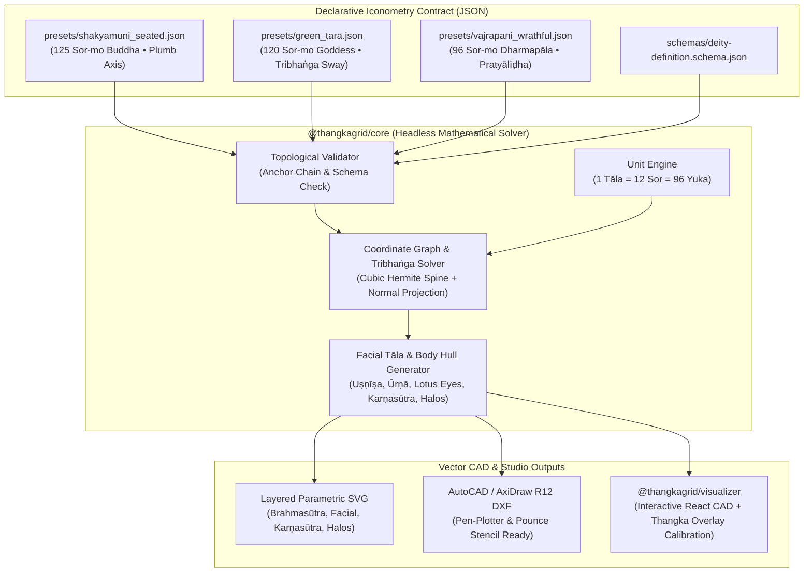

# ThangkaGrid ☸️📐

**Parametric vector engine, declarative JSON schema, and interactive CAD visualizer for sacred Himalayan iconometry (Tibetan *Thangka Thigse* and Newari *Paubha* art).**

[](./LICENSE)
[](https://www.typescriptlang.org/)
[](./schemas/deity-definition.schema.json)
[](#quick-start-cli--web-cad)

---

## Context & Domain Background

Traditional Himalayan Buddhist paintings—Tibetan **Thangka** (*thang-ka*) and Kathmandu Valley Newari **Paubha** (*pau-bhā*)—are never drawn freehand. For over a millennium, master painters have constructed every sacred figure over a rigorous, scale-invariant, self-referential proportional coordinate system called **Thigse** (Tibetan: ཐིག་ཚད་ *thig-tshad*, derived from Sanskrit iconometric treatises such as the *Citralakṣaṇa* of Nagnajit, the *Kālacakra Tantra*, the Newari *Pratimāmānalakṣaṇa*, and Desi Sangye Gyatso's 1687 encyclopedic manual *Vaiḍūrya dKar-po* / *The White Beryl*).

### The Proportional Unit System (`Sor-mo`, `Yuka`, `Tāla`)

Unlike Western CAD systems anchored in fixed physical millimeters or pixels, *Thigse* is **purely topological and ratio-driven**:

| Unit Name | Tibetan (*Wylie*) | Sanskrit | Equivalence | Anatomical Reference |
| :--- | :--- | :--- | :--- | :--- |
| **Yuka** | ནས་ (*nas*) | *Yava* | `1/8 Sor-mo` | Width of one plump barley grain |
| **Sor-mo** | སོར་མོ་ (*sor-mo*) | *Aṅgula* | `1 Sor = 8 Yuka` | Width of the deity's own middle finger knuckle |
| **Tāla** | མཐོ་ (*mtho*) | *Tāla* | `1 Tāla = 12 Sor = 96 Yuka` | Vertical span of the face from hairline (*skra-mtshams*) to chin (*ko-sko*) |

### Canonical Proportional Classes

- **Enlightened Buddhas (*Tathāgatas*, e.g., Śākyamuni):** **125 Sor-mo** (`10 Tāla + 5 Sor` for the *Uṣṇīṣa* cranial dome and *Cūḍāmaṇi* flame jewel). In seated *Vajrāsana*, the figure spans `58 Sor-mo` above a `12 Sor-mo` *Padmāsana* lotus throne (`70 Sor-mo` total height).
- **Peaceful Bodhisattvas & Goddesses (e.g., Ārya Green Tārā, Avalokiteśvara):** **120 Sor-mo** (`10 Tāla` / *Daśatāla*), often animated by a **Tribhaṅga** (triple-bend) spinal S-curve deflecting at the neck, heart chakra, and pelvis.
- **Wrathful Protectors & Herukas (e.g., Vajrapāṇi, Mahākāla):** **96 Sor-mo** (`8 Tāla` / *Aṣṭatāla*) compact heroic proportion with a square `12-Sor` face, `2-Sor` bull neck, distended belly (*gsus-khyim*), and dynamic *Pratyālīḍha* lunging stance.

---

## Visual Architecture & Iconometric Grid Topology



### Canonical Seated Buddha Vertical Axis (`70 Sor-mo` Active Grid)

```text
   Y = 0 Sor   ▲  crown_top      ─┬─ 2 Sor  : Cūḍāmaṇi Flame Jewel (gtsug-gi nor-bu)
   Y = 2 Sor   ┼  ushnisha_top   ─┼─ 4 Sor  : Uṣṇīṣa Cranial Dome (dbu gtsug-tor)
   Y = 6 Sor   ┼  hairline       ─┼─ 4 Sor  : Forehead (skra-mtshams to mdzod-spu)      ┐
   Y = 10 Sor  ┼  urna (3rd eye) ─┼─ 4 Sor  : Mid-Face & Eyes (mdzod-spu to sna-rtse)   ├─ 1 Tāla (12 Sor Face)
   Y = 14 Sor  ┼  nose_base      ─┼─ 4 Sor  : Lower Face & Lips (sna-rtse to ko-sko)    ┘
   Y = 18 Sor  ┼  chin           ─┼─ 4 Sor  : Conch-Striated Neck (mgrin-pa)
   Y = 22 Sor  ┼  neck_base      ─┼─ 12 Sor : Upper Chest (mgrin-pa to thugs-ka Heart)  ─► 1 Tāla
   Y = 34 Sor  ┼  heart          ─┼─ 12 Sor : Abdomen (thugs-ka to lte-ba Navel)        ─► 1 Tāla
   Y = 46 Sor  ┼  navel          ─┼─ 12 Sor : Pelvis & Vajrāsana Crossed Legs           ─► 1 Tāla
   Y = 58 Sor  ┼  throne_top     ─┼─ 12 Sor : Moon Disc & Double-Petal Padmāsana Throne ─► 1 Tāla
   Y = 70 Sor  ▼  throne_base    ─┴─────────────────────────────────────────────────────
                  Brahmasūtra (Tshangs-thig) Central Plumb / Tribhaṅga Axis (X = 0)
```

---

## Repository Structure

```text
ThangkaGrid/
├── schemas/
│   └── deity-definition.schema.json   # Draft 2020-12 JSON Schema for Sor-mo/Yuka deity definitions
├── presets/
│   ├── shakyamuni_seated.json         # 125 Sor-mo Seated Shakyamuni Buddha (Vajrāsana, Menri lineage)
│   ├── green_tara.json                # 120 Sor-mo Ārya Green Tārā (Tribhaṅga sway, Lalitāsana)
│   └── vajrapani_wrathful.json        # 96 Sor-mo Wrathful Vajrapāṇi (Pratyālīḍha lunge)
├── packages/
│   ├── core/                          # @thangkagrid/core — Headless solver, validator, SVG & DXF engines
│   │   ├── src/
│   │   │   ├── types.ts               # Core data structures & geometric primitive interfaces
│   │   │   ├── units.ts               # Sor-mo, Yuka (1/8), and Tāla (12x) conversion utilities
│   │   │   ├── validator.ts           # Anchor-chain & schema validator
│   │   │   ├── solver.ts              # Coordinate graph & Tribhaṅga cubic Hermite spinal solver
│   │   │   ├── svg.ts                 # Multi-layer parametric SVG renderer (4 pigment themes)
│   │   │   ├── dxf.ts                 # AutoCAD R12 / AxiDraw pen-plotter ASCII DXF exporter
│   │   │   └── presets.ts             # Built-in canonical preset registry
│   │   └── test/
│   │       └── solver.test.ts         # Vitest mathematical & geometric test suite
│   ├── cli/                           # @thangkagrid/cli — `thangkagrid` command-line tool
│   │   └── src/index.ts               # CLI for `render`, `validate`, `inspect`, and `presets`
│   └── visualizer/                    # @thangkagrid/visualizer — Interactive React + Vite CAD Studio
│       └── src/App.tsx                # Pan/zoom canvas, layer toggles, Tribhaṅga sliders & image overlay
├── .github/
│   └── ISSUE_TEMPLATE/                # 4 seeded contributor issues (good first issue, math, frontend, heritage)
├── ROADMAP.md                         # 130+ hour multi-milestone engineering roadmap
├── CONTRIBUTING.md                    # Guide for adding deity presets and developing on the monorepo
└── LICENSE                            # MIT License
```

---

## Quick-Start: CLI & Web CAD Studio

### Prerequisites

- **Node.js** `>= 20.0.0`
- **npm** `>= 10.0.0`

### 1. Clone, Install & Build

```bash
git clone https://github.com/adhikari18/ThangkaGrid.git
cd ThangkaGrid
npm install
npm run build
```

### 2. Run the Mathematical Test Suite

```bash
npm test
```

### 3. Launch the Interactive Web CAD Visualizer

```bash
npm run dev
```

Open **[http://localhost:5173](http://localhost:5173)** in your browser to:
- Pan and zoom across the infinite coordinate canvas with live `Sor-mo`, `Yuka`, and `Tāla` cursor readouts.
- Toggle individual construction layers (`Brahmasūtra`, `Canonical Facial Grid`, `Horizontal Anatomy`, `Karṇasūtra Diagonals`, `Śiraścakra & Prabhāmaṇḍala Halos`, `Body Hull Contours`, `Padmāsana Throne`).
- Adjust **Tribhaṅga** spinal sway sliders (`Head Tilt °`, `Neck Sway`, `Heart Cakra Sway`, `Waist Sway`, `Pelvic Counter-Sway`) in real time.
- Upload a historical Thangka or Paubha scan and calibrate its opacity, scale, offset, and rotation against the mathematical grid.
- Export one-click **SVG Wireframes** or **AxiDraw-ready `.dxf` CAD files**.

### 4. Use the `thangkagrid` CLI

```bash
# List all built-in canonical deity presets
npm run cli -- presets

# Validate a deity preset JSON file against schema & topological rules
npm run cli -- validate presets/shakyamuni_seated.json

# Inspect solved vertical segments and anatomical anchor coordinates
npm run cli -- inspect presets/green_tara.json

# Render a parametric SVG wireframe (supports --theme traditional|blueprint|monochrome|dark)
npm run cli -- render presets/shakyamuni_seated.json --format svg --theme traditional --out shakyamuni.svg

# Export an AutoCAD / AxiDraw pen-plotter DXF file
npm run cli -- render presets/green_tara.json --format dxf --out green_tara.dxf
```

---

## Contributing & Seeded Issues

We welcome contributors across computational geometry, React/SVG visualization, and Himalayan art history! Check out our ready-to-tackle issues in [`.github/ISSUE_TEMPLATE/`](./.github/ISSUE_TEMPLATE/):

1. **`good first issue` / `heritage`:** [Add Canonical 120-Sor Four-Armed Avalokiteśvara (Chenrezig) Preset](./.github/ISSUE_TEMPLATE/01-good-first-issue-deity-preset.md)
2. **`math` / `core`:** [Arc-Length Parameterized Tribhaṅga Spline & Multi-Arm Radial IK Solver](./.github/ISSUE_TEMPLATE/02-math-tribhanga-multi-arm-ik.md)
3. **`frontend` / `visualizer`:** [Two-Point Landmark Homography Calibration & Residual Error Heatmap](./.github/ISSUE_TEMPLATE/03-frontend-twopoint-homography-calibration.md)
4. **`heritage` / `documentation`:** [Bilingual Sanskrit–Tibetan–Newari Iconometric Glossary & Treatise Citations](./.github/ISSUE_TEMPLATE/04-heritage-sanskrit-tibetan-newari-glossary.md)

See [CONTRIBUTING.md](./CONTRIBUTING.md) and [ROADMAP.md](./ROADMAP.md) for full details.

---

## License

Released under the [MIT License](./LICENSE).

